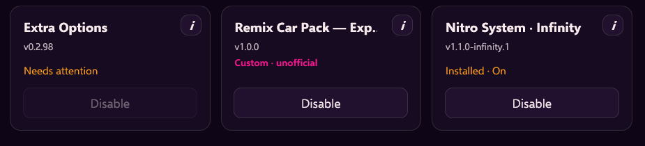

O launcher **1.0.9** saiu: [notas da versão no GitHub](https://github.com/anarqz/InfinityHorizon/releases/tag/v1.0.9). Se a atualização automática não funcionar para você, baixe e use essa versão daqui em diante.

## Mods no jogo online

Testado online com carros modificados e com o Nitro. Jogadores com mods que afetam o multiplayer se encontram em lobbies com exatamente os mesmos mods.

## Lobbies com mods

Os lobbies criados com mods ativos aparecem no filtro **Modded** do overlay. Vou continuar trabalhando firme para trazer mais suporte a mods e pacotes de carros ao Infinity Horizon.

## Novo atalho do overlay

Se segurar VIEW não abria o overlay para você, segure **LB + RB** por cerca de um segundo.

> Atualização: desde o launcher 1.0.11 a Remix Car Pack está no catálogo oficial de mods. Não é mais preciso descompactar à mão: abra Mods, escolha a pasta do pacote e o launcher faz o resto.
